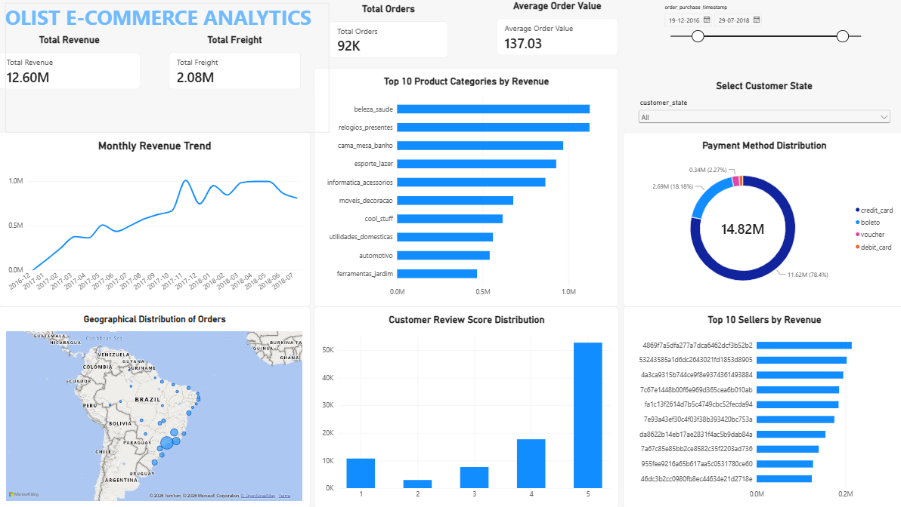

Olist E-Commerce Sales & Customer Analytics

Project Overview
An end-to-end e-commerce data analytics project using Brazilian Olist e-commerce data to analyze sales performance, customer behavior, product categories, payment methods, and seller performance.

Tools Used
- MySQL – Data Analysis and Business Queries
- Power BI – Interactive Dashboard
- Excel – Data Analysis and Visualization

Project Work
- Data cleaning and preparation
- Database creation and data modeling
- SQL business analysis queries
- Sales and customer analysis
- KPI calculations
- Interactive Power BI dashboard
- Dashboard visualization and insights

 📊 Dashboard Previews

1. Power BI Dashboard

2. Excel Dashboard

[📥 Download Excel Dashboard](excel/Olist_Excel_Dashboard.xlsx)
